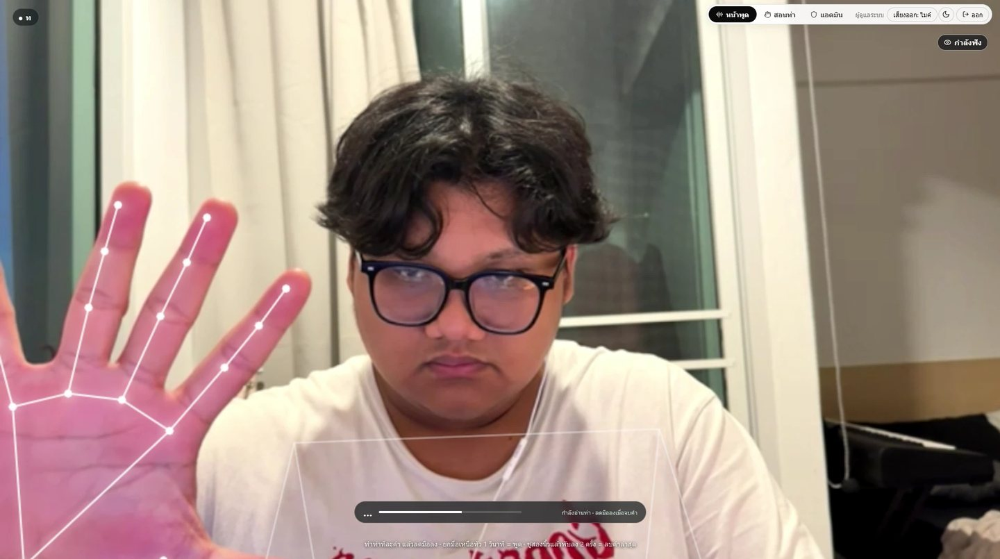
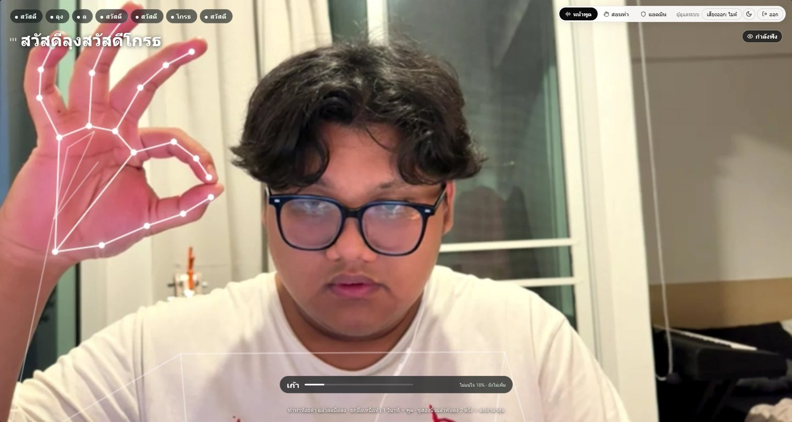
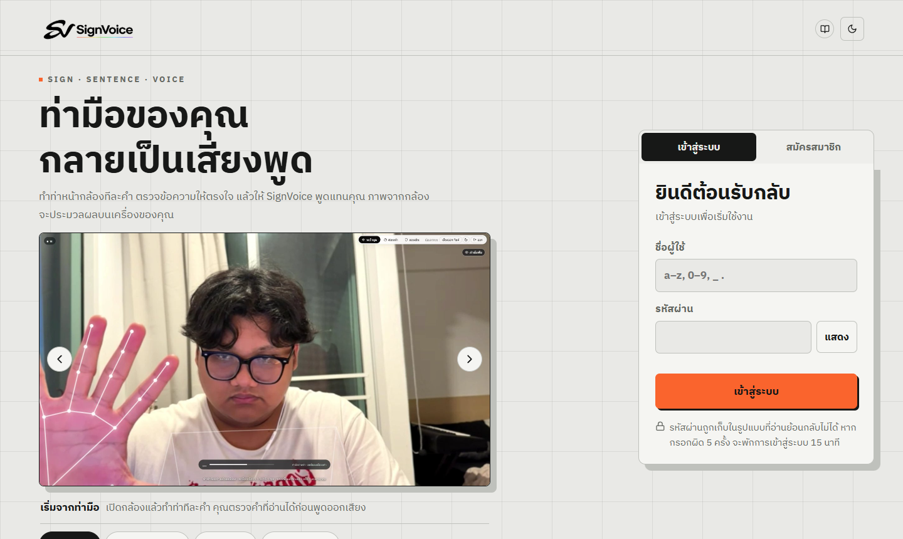
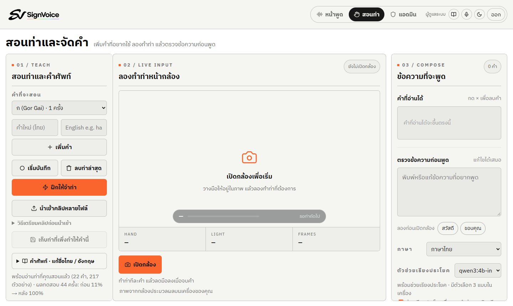
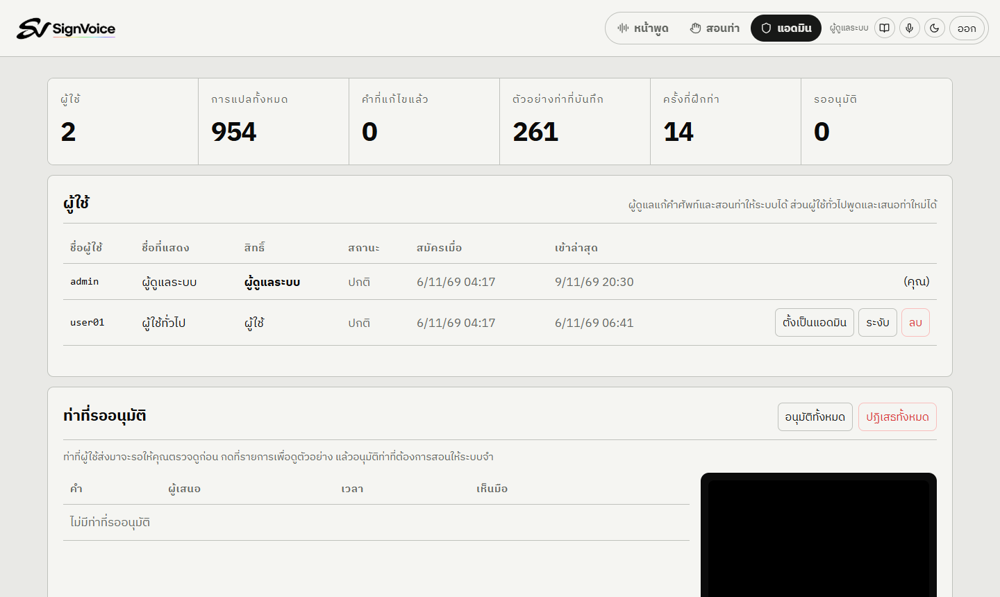
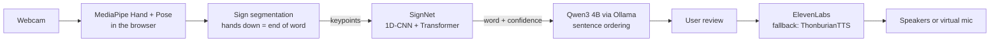

<p align="center">
  <picture>
    <source media="(prefers-color-scheme: dark)" srcset="docs/brand/logo-reveal-dark.gif">
    
  </picture>
</p>

<p align="center">Thai Sign Language to speech, from an ordinary webcam.</p>

<p align="center">
  
  
</p>

SignVoice reads Thai signs from a webcam, turns them into words, arranges the words into a Thai sentence and speaks it. Video never leaves the browser; only hand and arm keypoints are sent to the local server.

## Features

- **Speak view** (`/?view=speak`): full-screen camera. Sign one word at a time and lower your hands between words. Raise a hand above your head for one second to speak; fold two fingers twice to delete the last word.
- **Meeting output**: send the voice to your speakers or to a virtual microphone (for example VB-Audio Cable) for Zoom, Meet, Teams or Discord.
- **Teach view** (`/`): record new signs or import clips, then retrain on this machine with one click.
- **Review queue**: regular users propose signs; an admin checks the skeleton preview before they are used for training.
- **Accounts**: scrypt password hashing, session cookies, rate limits and account lockout. See [SECURITY.md](SECURITY.md).
- Light and dark themes, an in-app tour, left-handed signing.

| Login | Teach | Admin |
|---|---|---|
|  |  |  |

## How it works



The browser talks only to the Node server. The server checks the session, calls the Python service for recognition and training, Ollama for sentences and ElevenLabs for speech. Everything is stored in one SQLite file. Details: [docs/ARCHITECTURE.md](docs/ARCHITECTURE.md).

## Results

Tested on signers the model never saw during training.

| Measure | Result |
|---|---:|
| Sign accuracy, 5 held-out TSL-ONE signers (236 classes) | **86.2%** |
| Sign accuracy, held-out TSL-51 signer | 78.8% |
| Sentence ordering, 41 cases: Qwen3 4B / Gemma 3 4B / Llama 3.2 3B / no LLM | **92.7%** / 70.7% / 68.3% / 26.8% |
| Confidence threshold 0.35: precision of accepted words | 84.9% → 90.8% |
| Mirrored training data: left-handed signers | 20.1% → 81.4% |

The recogniser is trained on TSL-51 and TSL-ONE (32 signers) and uses 146 everyday words. Methods and full numbers: [docs/EXPERIMENTS.md](docs/EXPERIMENTS.md).

## Getting started (Windows)

Requirements: Node.js 20+, Chrome or Edge, [Ollama](https://ollama.com), and ideally an NVIDIA GPU. Large files (Python venv, datasets, models) live in `%USERPROFILE%\.signvoice`, outside the repo.

```powershell
git clone https://github.com/Patcharanat23/SignVoice.git
cd SignVoice
npm ci
npm run setup:ml              # first run: Python 3.12, PyTorch, datasets, model training
ollama pull qwen3:4b-instruct
npm run dev                   # http://127.0.0.1:5173
```

For ElevenLabs voices, create a `.env` file (it is git-ignored):

```env
ELEVENLABS_API_KEY=...
```

Without a key the app uses ThonburianTTS on your machine. The first account to register becomes the admin.

Production: `npm run build`, then `npm start`. To move the app to another machine or host it for others, see [DOCKER.md](DOCKER.md).

## Tests

```powershell
npm test               # unit tests
npm run test:security  # login, permissions and headers against a running server
npm run eval:tsl       # recognition accuracy through a real browser
```

## Limitations

- Isolated signs only. You lower your hands between words; continuous signing is not supported yet.
- Evaluated on 6 unseen signers, not yet with Deaf users in daily use.
- Similar signs still get confused (for example น้า and อา), so the sentence is always shown for review before it is spoken.
- TSL-51, TSL-ONE and ThonburianTTS are licensed for non-commercial use. See [LICENSES.md](LICENSES.md).

## Team

Advanced Topics in Computer Software, Rajamangala University of Technology Thanyaburi (RMUTT)

- พัชรณัฏฐ์ บุตรพลอย
- สิรวิชญ์ ศิริสลุง
- กฤษณพงศ์ พรภู่
