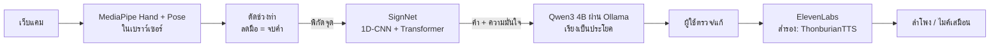

<p align="center">
  
</p>

<p align="center"><b>แปลภาษามือไทยจากกล้องเว็บแคม → เรียงเป็นประโยค → พูดออกมาเป็นเสียง</b><br>
ภาพจากกล้องประมวลผลบนเครื่องผู้ใช้ทั้งหมด ส่งต่อแค่ตำแหน่งจุดของมือ</p>

<p align="center">
  
  
</p>

## ความสามารถ

- **หน้าพูด** (`/?view=speak`) เต็มจอ ทำท่าทีละคำแล้วลดมือ คำจะขึ้นเป็นป้าย AI เรียงเป็นประโยคภาษาไทย ผู้ใช้แก้ได้ก่อนพูด
  - ยกมือเหนือหัวค้าง 1 วินาที = พูด
  - ชูสองนิ้วแล้วพับลง 2 ครั้ง = ลบคำล่าสุด
- **ส่งเสียงเข้าห้องประชุม** เลือกให้เสียงออกลำโพง หรือไมค์เสมือน (เช่น VB-Audio Cable) เพื่อใช้กับ Zoom, Meet, Teams, Discord
- **หน้าสอนท่า** (`/`) อัดท่าใหม่หรือนำเข้าคลิปหลายไฟล์ แล้วกด "ฝึกให้จำท่า" เพื่อเทรนต่อในเครื่อง
- **ผู้ใช้เสนอท่า แอดมินอนุมัติ** ท่าที่ผู้ใช้ทั่วไปเสนอจะรอให้แอดมินดูโครงมือก่อนนำไปเทรน
- **บัญชีผู้ใช้และสิทธิ์** รหัสผ่านเก็บแบบ scrypt ล็อกการเข้าสู่ระบบชั่วคราวเมื่อกรอกผิดหลายครั้ง รายละเอียดใน [SECURITY.md](SECURITY.md)
- ธีมสว่าง/มืด, คู่มือแนะนำในหน้าเว็บ, รองรับคนถนัดซ้าย

| หน้าล็อกอิน | หน้าสอนท่า | หน้าแอดมิน |
|---|---|---|
|  |  |  |

## การทำงานของระบบ



| ส่วน | ไฟล์หลัก | หน้าที่ |
|---|---|---|
| หน้าเว็บ | `src/` (Vite) | กล้อง, MediaPipe, ตัดช่วงท่า, UI |
| เซิร์ฟเวอร์ | `server.mjs`, `auth.mjs` | REST API, ล็อกอินและสิทธิ์, เรียก Ollama และ ElevenLabs |
| งาน AI | `ml/service.py` | แปลท่าด้วย ONNX, เทรนต่อ (fine-tune), อ่าน/เขียนข้อมูลท่า |
| ฐานข้อมูล | `ml/db.py` | SQLite ไฟล์เดียว `~/.signvoice/signvoice.db` (ผู้ใช้ ท่า คำ ประวัติ ผลเทรน) |

เบราว์เซอร์ไม่แตะฐานข้อมูลตรง ทุกคำขอผ่านเซิร์ฟเวอร์ Node.js ก่อน

## ผลการทดลอง

ทดสอบโดยแบ่งชุดทดสอบตามคน (ผู้แสดงที่โมเดลไม่เคยเห็น)

| การวัด | ผล |
|---|---:|
| แปลท่าถูก, ผู้แสดงใหม่จาก TSL-ONE (5 คน) | **86.2%** |
| แปลท่าถูก, ผู้แสดงใหม่จาก TSL-51 | 78.8% |
| ตัวหาจุดมือ Hand + Pose เทียบ Holistic (104 คลิป) | 80.8% / 14–19 FPS เทียบ 78.8% / 6–9 FPS |
| เรียงประโยคถูกทุกเกณฑ์ (41 กรณี): Qwen3 4B / Gemma 3 4B / Llama 3.2 3B / ไม่ใช้ LLM | **92.7%** / 70.7% / 68.3% / 26.8% |
| เกณฑ์ความมั่นใจ 0.35: ความแม่นของคำที่รับ | 84.9% → 90.8% |
| เทรนเพิ่มด้วยท่ากลับซ้าย-ขวา: คนถนัดซ้าย | 20.1% → 81.4% |

โมเดลแปลท่าเทรนจาก TSL-51 + TSL-ONE (ผู้แสดง 32 คน) ใช้งานจริง 146 คำในชีวิตประจำวัน รายละเอียดอยู่ใน `docs/*.json` และ [MODEL_COMPARISON.md](MODEL_COMPARISON.md)

## ติดตั้งและรัน (Windows)

ต้องมี Node.js 20+, Chrome หรือ Edge, [Ollama](https://ollama.com) และแนะนำการ์ดจอ NVIDIA ไฟล์ใหญ่ (venv, ชุดข้อมูล, โมเดล) เก็บที่ `%USERPROFILE%\.signvoice` นอกโฟลเดอร์โปรเจกต์

```powershell
git clone https://github.com/Patcharanat23/SignVoice.git
cd SignVoice
npm ci
npm run setup:ml              # ครั้งแรก: Python 3.12 + PyTorch, ดาวน์โหลดชุดข้อมูล แล้วเทรนโมเดล
ollama pull qwen3:4b-instruct
npm run dev                   # http://127.0.0.1:5173
```

สร้างไฟล์ `.env` ที่โฟลเดอร์โปรเจกต์ (ไม่ถูก commit) ถ้าต้องการเสียง ElevenLabs:

```env
ELEVENLABS_API_KEY=...
```

ไม่มีคีย์ก็ใช้งานได้ ระบบจะใช้เสียง ThonburianTTS ในเครื่องแทน บัญชีแรกที่สมัครจะเป็นผู้ดูแลระบบ

ใช้งานจริงแบบ production: `npm run build` แล้ว `npm start` ส่วนการย้ายไปเครื่องอื่นหรือเปิดเป็น host ดู [DOCKER.md](DOCKER.md)

## ทดสอบ

```powershell
npm test               # unit tests
npm run test:security  # ตรวจระบบล็อกอินและสิทธิ์
npm run eval:tsl       # วัดความแม่นยำผ่านเบราว์เซอร์จริง
```

## ข้อจำกัด

1. แปลทีละคำ (isolated sign) ต้องลดมือระหว่างคำ ยังแปลต่อเนื่องทั้งประโยคไม่ได้
2. ทดสอบกับผู้แสดงใหม่ 6 คน ยังไม่ได้ทดสอบกับผู้ใช้ภาษามือจริงจำนวนมาก
3. ท่าที่คล้ายกันยังสับสนได้ จึงให้ผู้ใช้ตรวจประโยคก่อนพูดเสมอ
4. ชุดข้อมูลและโมเดลเสียงบางตัวใช้สัญญาอนุญาต CC BY-NC-SA 4.0 ใช้เพื่อการศึกษาเท่านั้น ดู [LICENSES.md](LICENSES.md)

## เอกสารเพิ่มเติม

- [presentation/SYSTEM_GUIDE.md](presentation/SYSTEM_GUIDE.md) อธิบายระบบทั้งหมด
- [docs/THAI_SIGN_DATASETS.md](docs/THAI_SIGN_DATASETS.md) ชุดข้อมูลภาษามือไทย
- [SECURITY.md](SECURITY.md) ระบบความปลอดภัย
- [DOCKER.md](DOCKER.md) รันด้วย Docker

โปรเจกต์รายวิชา Advanced Topics in Computer Software, RMUTT
พัชรณัฏฐ์ บุตรพลอย · สิรวิชญ์ ศิริสลุง · กฤษณพงศ์ พรภู่
